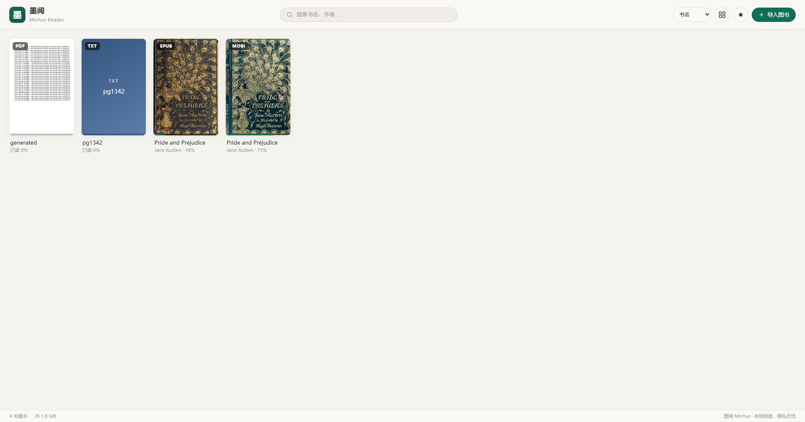
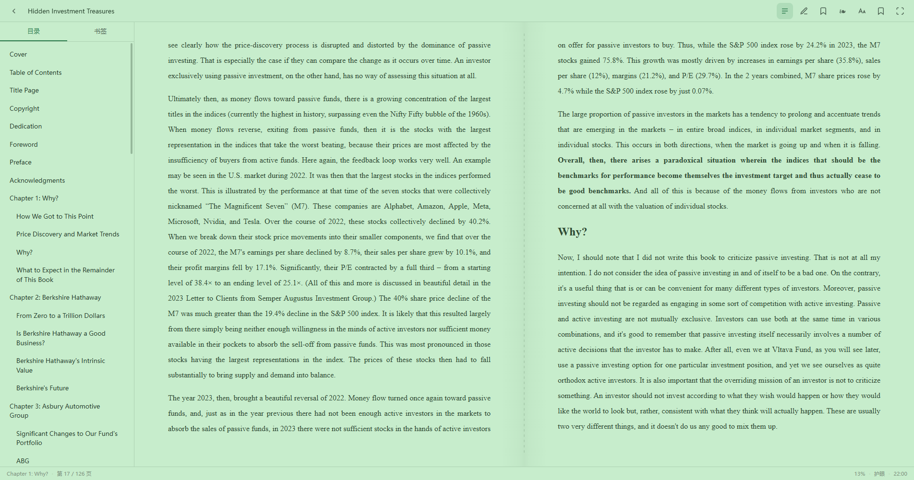

<div align="center">


# 墨阅 MoYue

**A local-first, paper-like ebook reader for Windows.**
EPUB · PDF · TXT · MOBI/AZW3 — two-page spreads, real book typography, and annotations that stay out of your way.

[](#-supported-formats)
[](#-install)
[](#-build-from-source)
[](#-privacy)
[](LICENSE)

[简体中文](README.zh-CN.md) · **English**

</div>

---

Most desktop readers still feel like a browser rendering a document. MoYue tries to feel like a **book**: two facing pages with a real gutter, margins that leave room for handwritten-style side notes, a page counter for the *whole book* rather than the current chapter, and a turn animation that lands exactly one page forward — never two.

It is a single-purpose, offline Windows app. No account, no sync, no telemetry, no network requests at runtime.

<div align="center">

</div>

## ✨ What makes it different

- **Two-page spreads, geometrically centred.** The text column is exactly as far from the gutter as it is from the outer page edge (measured: 140 px / 140 px in a 1904 px window). The empty margins on both sides are the point — that's where annotations live.
- **A page number for the whole book.** `Page 35 / 212`, not `chapter 3, page 2`. It advances by exactly 1 per turn and stays stable when you change font size, page mode, or window width.
- **The pointer belongs to text selection, not page turning.** Mouse drag / trackpad swipe paging is deliberately removed — it constantly misfired while highlighting. Paging is keyboard `←`/`→` or the hover arrows at the screen edges.
- **Real book typography.** 2-em first-line indent, 0.26 em paragraph spacing, justified text with `text-justify: inter-character`, `line-break: strict`, `text-spacing-trim` / `text-autospace` for CJK–Latin mixing. EPUB only gets an indent injected when the publisher supplied neither indent nor paragraph spacing.
- **A hand-written MOBI parser.** No conversion step, no Calibre. PalmDOC LZ77 + HUFF/CDIC, MOBI6 and KF8, EXTH metadata, cover & inline image extraction, DRM detection.
- **Annotations with three different locators.** CFI for EPUB, in-chapter text offsets for TXT/MOBI, in-page offsets for PDF — all landing in one store, exportable as Markdown.
- **82 MB installed, 77 MB download.** And it still ships full Chromium 144 typography features (see [Size](#-size-987-mb--77-mb)).

## 📚 Supported formats

| Format | Engine | Notes |
|---|---|---|
| EPUB | [epub.js](https://github.com/futurepress/epub.js) | Full reflow, two-page spread, CFI-based progress, TOC navigation |
| PDF | [pdf.js](https://github.com/mozilla/pdf.js) 4.10 | **Horizontal, page-by-page paging** (not vertical scroll), fit-to-page, lazy rendering, zoom, outline |
| TXT | Custom | Encoding auto-detection (BOM → strict UTF-8 → GB18030), chapter splitting for CJK & English patterns |
| MOBI / AZW3 | **Custom parser** | PalmDOC LZ77, HUFF/CDIC bit-stream, MOBI6 + KF8, EXTH, covers, embedded images, DRM detection |

Validated against 11 real-world MOBI samples with ≥ 98.8 % text completeness.

## 🎨 Themes & reading

Three paper themes — **Day** (warm white), **Night** (deep grey), **Eye-care** (soft green, RGB 199/237/204). Themes apply to the app chrome *and* are injected into the EPUB iframe, so switching is instant.

<div align="center">

<sub>EPUB two-page spread — WPS-style dotted gutter line, symmetric margins, TOC sidebar open</sub>
</div>

| Feature | Detail |
|---|---|
| Page modes | Single / two-page spread / continuous scroll, switchable any time |
| Turn effects | Slide (default), fade, none |
| Margins | Adjustable — the geometry keeps inner and outer margins equal |
| Typography | Font size, line height, family (system / Song / Hei / Kai / Times New Roman), margin |
| Highlights | 6-colour highlighter from the toolbar or the selection popover |
| Comments | Word-style marginal notes; all annotations listed in a side drawer, jump / edit / delete, export to Markdown |
| Bookmarks | `Ctrl+B`, one-click jump back |
| Progress | Per-book position (CFI / page / scroll ratio) plus annotations, restored on reopen |

<div align="center">

<sub>TXT — encoding auto-detected, 2-em indent, justified, chapter split, whole-book page numbers</sub>
</div>

### Keyboard

| Key | Action |
|---|---|
| `←` `→` / `PgUp` `PgDn` / `Space` | Page back / forward |
| `H` | Highlighter palette |
| `N` | Annotations drawer |
| `T` | TOC / bookmarks panel |
| `M` | Cycle theme |
| `F` | Typography settings |
| `Ctrl+B` | Add bookmark |
| `F11` | Full screen |
| `Esc` | Close panel / leave immersive mode / back to library |

> **Selecting text:** long-press (~420 ms) to enter selection mode, then drag to extend. Highlight or comment from the popover that appears on release.

## 📥 Install

Grab the latest build from [**Releases**](https://github.com/haunledeshuchang/moyue-reader/releases/latest):

| Build | File | Notes |
|---|---|---|
| Installer | `墨阅MoYue-0.1.1-x64.exe` | Per-user install, creates desktop & Start-menu shortcuts, registers file associations |
| Portable | `墨阅MoYue-0.1.1-便携版.exe` | Single executable, no installation |

Windows x64. The binaries are unsigned, so SmartScreen may ask you to confirm once (*More info → Run anyway*).

## 🔨 Build from source

```bash
# Node.js 22+
npm install
npm start          # dev
npm run dist       # installer + portable in dist/
```

If the Electron binary download is slow, use the mirror:

```bash
npm config set electron_mirror https://npmmirror.com/mirrors/electron/
```

Import books by clicking **Import** (top-right), dragging files into the window, or double-clicking a book in Explorer.

## 🏗 Architecture

```
moyue-reader/
├── main.js                     # Main process: windows, custom protocols, library storage
├── preload.js                  # contextBridge-exposed API surface
├── src/
│   ├── index.html              # Library
│   ├── reader.html             # Reader
│   ├── js/
│   │   ├── bookshelf.js        # Grid/list views, cover extraction, search & sort
│   │   ├── reader.js           # Format routing, shortcuts, progress, annotation glue
│   │   ├── themes.js           # CSS-variable theme system + font stacks
│   │   ├── page-turn.js        # Paging gestures: arrows/keyboard + long-press selection
│   │   ├── annotations.js      # 6 colours, three locator schemes, persistence
│   │   ├── selection-toolbar.js
│   │   ├── parsers/
│   │   │   ├── mobi-parser.js  # PalmDOC / HUFF-CDIC / KF8
│   │   │   └── txt-parser.js   # Encoding detection & chapter splitting
│   │   └── renderers/
│   │       ├── epub-renderer.js
│   │       ├── pdf-renderer.js
│   │       └── text-renderer.js
│   ├── vendor/                 # epub.js, jszip, pdf.js (vendored, no CDN)
│   └── css/
└── build/                      # Icon generator + afterPack size trimming
```

Data lives entirely in `%APPDATA%/moyue-reader/` (`library.json`, `books/`, `annotations/`).

## 🔬 Notes from building this

Things that cost days and are worth writing down.

1. **CSS multi-column silently stretches columns.** `column-width` is a *suggestion*: if the container isn't exactly `n × column + gaps`, the browser widens the columns to fill it — text ends up pressed against the gutter or the right edge. You must set the container to `2 × colW + gap` (spread) or `colW` (single) explicitly, and centre it with `offset = (half − colW) / 2`.
2. **epub.js ignores `gap` in single-page mode.** `layout.calculate()` sets `columnWidth = stage width` whenever `divisor === 1`. Faking margins with a full-width stage plus huge padding desynchronises the internal geometry from the DOM — `displayed.total` collapses to 2 and paging jumps by a whole screen. Fix: shrink the *stage* to the text column and centre it, pass `gap: 0`.
3. **`displayed` is measured in columns, not pages.** Both modes have the same column width, so pages = columns ÷ 2 — forget that and your two-page count is exactly double.
4. **`locations` are too coarse for page numbers.** At 1200 characters per location, one location spans 2–3 columns, so naive conversion makes the counter jump +2/+3. Final approach: sample characters-per-column per *layout signature* and lock the value, then compute the page as `chapter base column (derived once from `locationFromCfi` and cached) + column index within the chapter`.
5. **`currentLocation()` calls `updateLayout()` internally.** Read the CFI *before* resizing the stage, otherwise the position snaps back to the start of the chapter.
6. **pdf.js text layer mirrors vertically.** `item.transform` is in PDF's bottom-up space; take `tx[4]/tx[5]` directly and the selection layer is flipped against the canvas. Compose the viewport matrix first: `screenX = a·x + c·y + e`, `screenY = b·x + d·y + f`.
7. **`<mbp:pagebreak/>` breaks HTML parsers.** A self-closing Kindle tag is parsed as an unclosed element, so the rest of the book becomes its child. It is replaced with a harmless marker before parsing.
8. **EPUB cannot use XHR under a custom protocol.** Loading goes through a `fetch`-based `requestMethod` for epub.js and a plain `fetch` → `ArrayBuffer` for PDF.
9. **rAF stalls in background windows.** epub.js drives its layout queue with `requestAnimationFrame`; when the window is hidden Chromium stops emitting frames and paging deadlocks. The renderer falls back to `setTimeout`, and the main process disables background throttling.
10. **Two-phase page-turn for EPUB.** Slide out for 150 ms → swap the page → slide in for 175 ms, with the seam dropped to 25 % opacity to hide the swap frame. TXT/MOBI use `translate3d` with `cubic-bezier(.22,.61,.36,1)` over 320 ms — measured 16.8 ms average frame time, zero frames over 20 ms.

## 📦 Size: 98.7 MB → 77 MB

Electron apps are mostly Chromium, so the levers are limited — but real:

- **Runtime downgrade** Electron 44 → **40** (Chromium 144). Installer 98.7 → 77 MB. `text-spacing-trim`, `text-autospace` and `color-mix` all survive.
- **Trim what a reader never touches.** `build/afterPack.cjs` deletes `dxcompiler.dll` / `dxil.dll` (25.9 MB of Dawn/WebGPU shader compiler). `vk_swiftshader` (software fallback) and `LICENSES.chromium.html` are kept.
- **Pin pdf.js to 4.10.38.** pdfjs-dist 6.x needs `Uint8Array.prototype.toHex` and `Map.prototype.getOrInsertComputed` — Chromium 150+ APIs — and dies with `hashOriginal.toHex is not a function` on anything older.
- **Two locales only:** `electronLanguages: ["zh-CN", "en-US"]` cuts Electron's 55 locale packs down to 2.

Around 80 % of what's left is the Chromium runtime itself (204 MB uncompressed). Going smaller means WebView2 or Tauri — and giving up epub.js multi-column pagination and pdf.js rendering parity. Not a trade worth making for a reading app.

## 🔒 Privacy

- Books, progress and annotations never leave the machine: `%APPDATA%/moyue-reader/`
- No account, no sync, no telemetry, no network requests at runtime

## ⚠️ Known limitations

- MOBI files with strong DRM cannot be parsed (the app says so explicitly)
- Scanned PDFs have no text layer — image-only, no OCR
- MOBI chapter detection relies on heading patterns; unusual layouts may show a single "full text" chapter

## 🗺 Roadmap

- [ ] macOS / Linux builds
- [ ] Full-text search across the library
- [ ] Read-aloud (TTS)
- [ ] OPDS catalog support
- [ ] Import Calibre metadata

## 🤝 Contributing

Issues and pull requests are welcome — especially bug reports with a sample file and the exact window size, since most layout bugs are geometry bugs. If this project is useful to you, a ⭐ helps other readers find it.

## 📄 License

[MIT](LICENSE) © 2026 haunledeshuchang

---

<div align="center"><sub>墨阅 MoYue — read locally, keep it private.</sub></div>
